<div align="center">


</div>

**Real-time chess analysis, game review and automated play on Chess.com, Lichess, BlitzTactics, TakeTakeTake and
ChessBase Tactics.** Mephisto reads the position off the page and runs **Stockfish** (NNUE), **Fairy-Stockfish**, the
human-trained **Maia** nets or **Elite Leela** entirely in your browser, with no server and no account. It draws the best
move on the board or plays it for you with human timing, and it reviews finished games offline or through
**chess.com's own Game Review**.

Click the toolbar icon for a floating panel that stays open while you play.

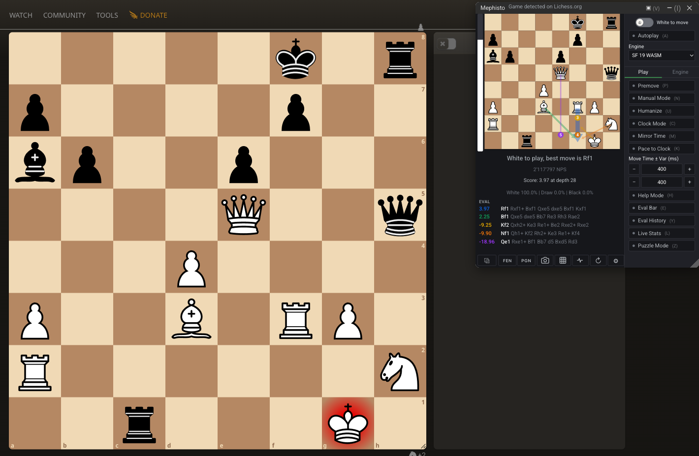

[Fair play](#fair-play---read-this-first) · [Install](#install) · [Engines](#engines) · [Features](#features) ·
[Sites](#supported-sites) · [Settings](#settings-reference) · [Error codes](#error-codes) · [Footprint](#page-footprint) · [Roadmap](#roadmap)

---

## Fair play - read this first

**Using this in a live game against another person violates the Terms of Service of every chess site.** Account
closures are permanent and applied at the device level.

**This extension cannot make you undetectable.** What catches engine users is server-side and statistical: move
agreement over many games, think-time distributions, accuracy that doesn't fit your history. The anti-detection work
here only addresses *passive client-side fingerprinting* (a site noticing the extension is installed), which even
[the people writing detection for it](https://github.com/AlexPetrusca/Mephisto/issues/35) call a corroborating
signal, not grounds for a sanction.

**Good for:** reviewing your own games, openings and endgames, puzzles, engine development, analysis boards and offline
play, and unrated games where your opponent knows. You are responsible for how you use this.

---

## Why this fork

An actively maintained continuation of [Mephisto by Alex Petrusca](https://github.com/AlexPetrusca/Mephisto), whose
scrapers no longer detect anything after the 2026 Chess.com and Lichess redesigns. Everything the original did still
works. New here:

- **Game Review** - an offline review (accuracy, move quality, eval graph, fair-play indicators) and **chess.com's own
  Game Review** on the same board, run from your own account.
- **Engines** - Stockfish 19 and 18, **Maia** (one rating slider, 600-2600), **Elite Leela**, **Rodent IV**, an Elo cap
  and ten **playstyles**.
- **Playing like a person** - Humanize, Clock Mode, Mirror Time.
- **Automation** - Premove, Pondering, Help Mode, Manual Mode, rebindable hotkeys and macros, and custom keys that
  toggle any on/off setting.
- **Beyond the engine** - Opening Explorer, endgame tablebase, puzzle database.
- **On screen** - eval bar, eval history graph, screen reading, screenshot-to-FEN, a playable panel board.
- **Coverage** - chess.com variants, four-player chess, TakeTakeTake, Chess960, **Shogi and Xiangqi** on the Analysis
  page, fourteen languages.
- **Under the hood** - a zero-iframe panel with no page-visible extension URLs, and settings export/import.

---

## Install

Mephisto is distributed as an unpacked extension, not through the stores.

1. Download or clone this repository.
2. Open `chrome://extensions` and enable **Developer mode**.
3. **Load unpacked**, then select the repository folder.
4. Pin it: puzzle icon right of the address bar, then pin "Mephisto Chess Extension".

Every [release](https://github.com/IchNukeDichWeg/Mephisto/releases) carries two archives:

| Archive | Size | Use it when |
|---|---|---|
| `mephisto-<version>.zip` | **~12 MB** | **First install.** Everything except the engine nets, which download on first use. |
| `mephisto-<version>-update.zip` | **~7 MB** | **Already installed.** Code only; extract *over* your existing folder. Not if you skipped a release whose notes say it needs the full zip (its engine files changed): use the full zip then. |

The engine nets and models (about 1 GB) are in neither archive. They live on two fixed releases,
[`engines-v1`](https://github.com/IchNukeDichWeg/Mephisto/releases/tag/engines-v1) and
[`models-v1`](https://github.com/IchNukeDichWeg/Mephisto/releases/tag/models-v1). On a fresh install each engine
downloads its net the first time it runs (Stockfish 19: 98.5 MB), checks it against a SHA-256 and caches it. This needs
the download permission Chrome asks for when you switch on **Automatic Updates** (Settings → Updates). An install from
an older full zip, or a git checkout, already has the nets.

> ⚠️ **Extract the update over your existing install, never into an empty folder.** Both archives unpack into a
> `Mephisto-<version>/` folder; copy that folder's *contents* over the folder Chrome already loaded. Extracting in
> place also keeps your extension id, which native engines are registered against.

To pick up a change, reload on `chrome://extensions`, then reload the game tab. The panel checks for a newer release at
most every 12 hours, from the service worker, so the chess page never makes the request.

### Automatic updates (opt-in)

Chrome never updates an extension you loaded yourself, so Mephisto can: **Settings → Updates**, **off by default**.
Switch it on (Chrome asks for permission to download from this repository's releases), choose your extension folder
once, and updating is one button that fetches the ~7 MB archive, writes it over that folder and reloads the extension.

It never installs by itself, never touches the bundled engines, refuses any folder that isn't this extension, and
checks the whole archive in memory before writing anything. Switching the feature off hands the permission back.
Updating by hand still works as before.

---

## Engines

Everything runs locally via WebAssembly: no server, no account, nothing leaves your machine. The **online** entry is
the one exception, and it is opt-in.

| Engine | Notes |
| --- | --- |
| **Stockfish 19 NNUE** | The default. The full dual-net build; the large net ships split and is stitched at load. |
| **Stockfish 19 Small NNUE** | The same engine on the small net (about 1 MB against 99), for a machine or connection that cannot take the full one. |
| **Stockfish 18 NNUE** | The previous mainline, kept so a review can be repeated against the engine that produced it. |
| **Stockfish 11 HCE** | Classical eval, no NNUE. Light and fast. |
| **Fairy-Stockfish 14 NNUE** | Required for [variants](#variants); each has its own bundled net. |
| **Maia** | Plays like a person of the rating you set in **Play like** (600-2600, changed live; Maia-3, a transformer conditioned on the rating). **Use opponent's rating** switches to Maia-2, which also takes the opponent's rating (read off the page on Lichess, or typed in), so a 1200 facing a 2000 plays differently from a 1200 facing a 1200. A saved Maia-1 or Maia-2 pick moves across at its rating. Maia-1's per-band nets are still in the Analysis page's **Compare nets**. |
| **Elite Leela** | A Leela net trained on the **Lichess Elite Database** (human games at 2200+). One forward pass: policy for the move, its own WDL head for the score. |
| **Tetrarch (4-player)** | Four-player chess only; see [four-player chess](#four-player-chess). One-time install. |
| **Remote / native** | A real engine binary outside the browser; see [full-power engines](#full-power-native-engines-optional). |
| **Rodent IV (native)** | A character engine with 36 personalities (Tal, Petrosian, Pawnsacker...) picked in Settings. Build once with `native-host/build-rodent.sh`, then run the installer. |
| **Stockfish 18 / 17.1 (online)** | Server-side Stockfish over HTTPS for a machine that cannot run one locally. **The position leaves your machine on every move** (one line only), so a local engine is faster and private. |

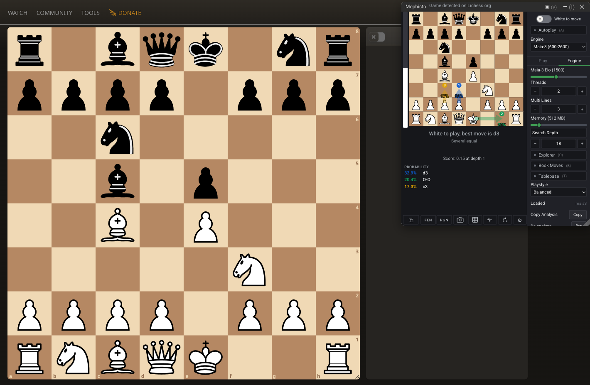 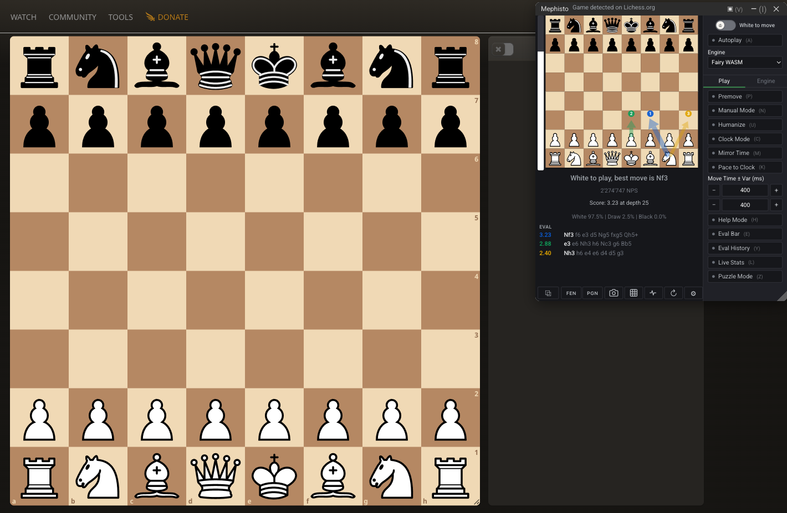

*Maia's live rating slider · Atomic analysed by Fairy-Stockfish*

Illegal scraped positions are blocked before they can crash the engine, and a crashed engine restarts automatically (3
attempts). **Strength cap** limits any Stockfish or Fairy engine to a target Elo on a slider that follows that engine's
real `UCI_Elo` range.

### Variants

**Chess960** works on every mainline Stockfish. Fairy-Stockfish adds all of Lichess's variants (Crazyhouse, King of the
Hill, Three-Check, Antichess, Atomic, Horde, Racing Kings) plus Chess.com's **Duck, Minihouse, Seirawan and
Chaturanga**. The ↻ button beside the variant selector detects the variant and switches engine for you. The bundled
chess.js can't replay the last four, so the panel says so rather than analysing the wrong position, and this Fairy
build has no Duck at all (see the [roadmap](#roadmap)).

---

## Features

### Analysis in the panel

- **Multiple lines** (MultiPV), each drawn with its rank and score (on a human net, its probability instead).
- **Eval bar** and a Lichess-style **eval history graph** marking opening, middlegame and endgame.
- **Threat analysis** (the opponent's strongest reply), **Move confidence** (how much better best is than second) and
  **Explain moves** (names the tactic, and stays quiet when it cannot be sure).
- **Opening Explorer** - the Lichess database: opening name, most-played replies with W/D/L, coloured arrows. Masters,
  all Lichess, or a club band. Needs a personal API token (see [Settings reference](#settings-reference)).
- **Read a position off the screen** - the camera button captures the tab, finds the board and loads it, on any site.
  **Follow screen** re-reads twice a second. Nothing is uploaded.
- **Playable panel board** - click or drag to walk a line, with underpromotion.
- **Second opinion** - a human-trained net answers the same position beside the engine, and says so when the engine's
  move is one a player of that rating almost never finds.
- **Suggest a Human Error** (off by default) - one move a player of your Play-like rating could realistically play that
  gives something away, drawn as a brown arrow and labelled ("Human error: Nxe5?! -1.4 (inaccuracy)"). A training aid,
  display only: Autoplay, Premove and Humanize never read it. It widens the search to 20 lines, so it costs depth.
- **Evals on Your Arrows** (off by default) - right-drag an arrow on the Lichess or Chess.com board and the engine
  writes the evaluation after that move at its head (+0.35, #3). It rates your move and never shows its own.
  **Replies on Your Arrows** (0 to 5) also draws the opponent's best answers. It uses its own one-thread Stockfish, so
  the main analysis is untouched. **Arrow Evals From** sets whose side the numbers are written from: White (default),
  your side, or the side to move.
- **Copy Analysis** copies the position, score, depth and every line as text. **Re-analyse** searches again from
  scratch, and **Loaded** names the engine build and net that answered.
- **Panel opacity and docking**, remembered per site, plus an optional **material balance** and **square-control
  heatmap**.

 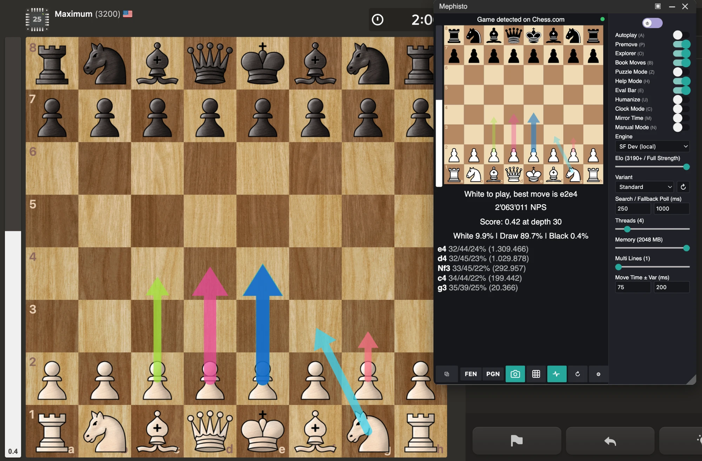

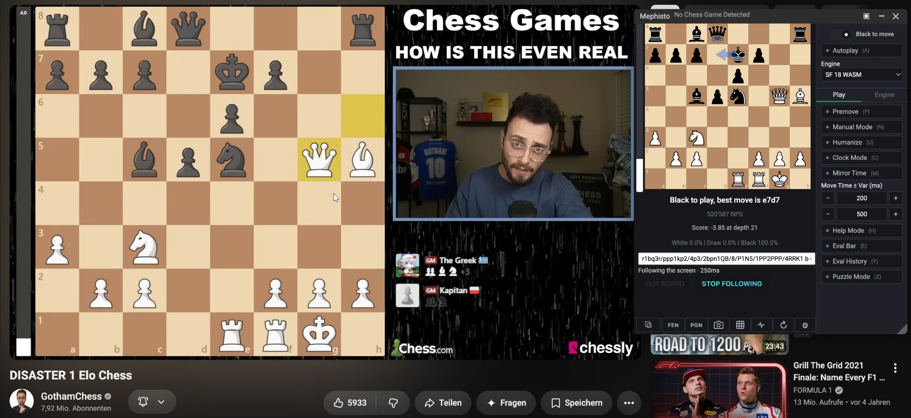

*Three candidate lines · the explorer's book moves · reading a position off a YouTube video, naming its
least-confident squares.*

### The Analysis page

A page of its own (**Settings → Analysis**) for studying rather than playing: a board you play on with a move list and
Copy FEN/PGN, the engine's lines next to what a human of a chosen rating would play, a search budget in time or depth
(or `go infinite`), W/D/L, and the moves of a loaded Polyglot book.

- **Moves by rating** charts every candidate across the whole rating range, so you can watch e4 fall away and d4 climb.
- **Compare nets** runs one position through Maia-1, Maia-2, Maia-3 and Elite Leela and tabulates what each would play.
- **Engine match** plays two engines against each other over as many games as you set, with every result, its reason and
  the PGN.
- **Shogi and Xiangqi** get their own boards on a large-board Fairy-Stockfish build, where the engine decides every
  rule.
- **Export** writes one self-contained file: board, FEN, line, chart and the numbers behind it.

### Game review (offline)

**Settings → Game Review.** Paste a PGN, load a `.pgn`, or fetch recent games from Chess.com's or Lichess's public API.
**Nothing leaves your machine**: the search runs in the extension's own engine.

- **Any game type** - chess, Chess960, the Fairy variants, and **4-player** PGN4 through Tetrarch.
- **Any engine at your budget** - bundled WASM or a native host, a fixed depth (default 16) or a time per move, 1-10
  lines. **Engines at once** (default 2) runs a worker pool; measured 64.7s down to 25.7s on the same game. The depth
  box also offers chess.com's own Game Review depths (18, 22, 24, 26), because two accuracy numbers only describe the
  same thing if they came from the same search.
- **Accuracy and move quality** on Lichess's formulas (with a wider ceiling: past +10 or with a mate on the board the numbers run higher than Lichess's) and the same bands the panel judges live moves by, so a review
  agrees with what the panel said at the time.
- **Eval graph**, **openings named offline** (from a bundled copy of
  [lichess-org/chess-openings](https://github.com/lichess-org/chess-openings), CC0) and **think time** from the
  `[%clk]` comments.
- **Human model** (optional) reports where your move sat in Maia's ranking. **Strength estimate** (optional) finds
  which rating best explains the moves played. It estimates strength; it is not a fair-play measurement.
- **Explain the moves** (optional) - chess.com's explanation engine writes a sentence per move and a line about the
  game, over this review: their words, our numbers. It needs the same offline download as the classifier below. Where
  their grade of a move differs from ours, the report keeps both.
- **Fair-play indicators** - engine-match rate over real choices, sharp positions, longest streak, accuracy uniformity,
  whether long thinks went to hard positions. **Measurements, never a verdict.**
- **Review every game** in a file in one pass, **export** the report as one file, or **share** it as an annotated PGN,
  a 1200x630 share card, or an import to lichess (which publishes the game and asks first). An anonymous lichess import
  drops every glyph, eval and comment (measured), so use **Add to my study** (a token with the `study:write` scope) to
  keep them.
- **Fit Humanize to a player** - counts a player's centipawn losses in the Humanize bands to get the move mix that
  reproduces them. It sets sliders that play only with **Err Like Your Rating** off.

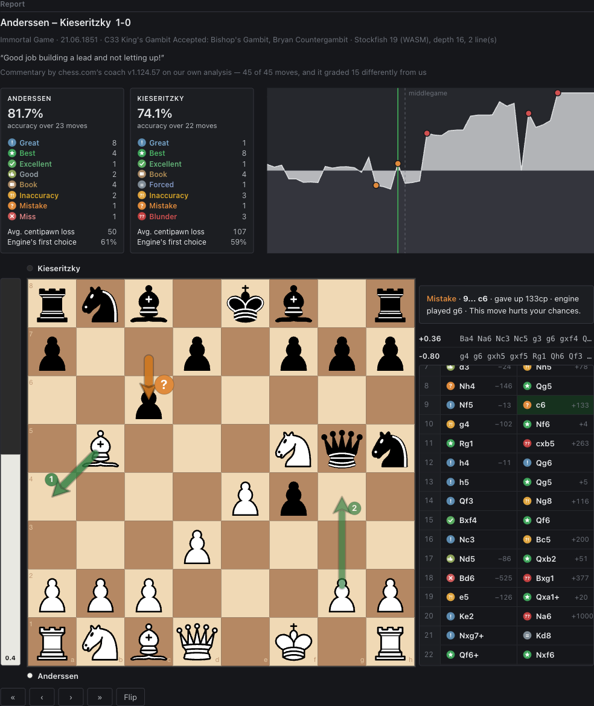

### chess.com Game Review

**chess.com's own Game Review, on Mephisto's board:** the real service, not an imitation. Load a game, press **Ask
Chess.com**, and every move comes back with chess.com's verdict, the coach's commentary, both accuracies and the named
opening, plus the centipawn score behind the eval bar and graph.

It runs on **your own chess.com account**, as their site does (Diamond reviews without limit; a free account gets the
free-tier allowance). Being signed in to chess.com in the browser is the whole requirement, with no token or password.
The PGN goes to chess.com; the [offline review](#game-review-offline) uploads nothing.

The strength tier is sent as chess.com's own ordinal 1-4. **Measured caveat:** on a Diamond account with the cache
defeated, their endpoint returns a byte-identical review for all four tiers, so the field is correct but their server
does not currently act on it.

### chess.com's classifier, offline

**chess.com's own move classifier, running on your machine: free, unlimited, network off.** It downloads chess.com's
engines and explanation engine and drives them the way their site does, so the verdicts are theirs: Book, Brilliant,
Great, Best, Excellent, Good, Forced, Inaccuracy, Mistake, Miss, Blunder, with the accuracies and a one-line
commentary.

Measured on nine diverse games (337 plies, ratings 1080-2812), each also reviewed by chess.com itself. **Decision
plies** exclude book moves, which both sides get free:

| what it reproduces | all plies | decision plies |
|---|---|---|
| **Post-game review** vs chess.com's free card | **96.2%** | **77.4%** |
| chess.com's free card vs **itself**, run twice | 94.1% | 64.2% |
| **Deep** vs their full **paid** Game Review | **86.7%** | **73.7%** |
| **Maximum / Standard / Fast** vs the same | 84.9 / 83.7 / 83.1% | 70.2 / 67.8 / 66.7% |
| *their own free card* vs their own paid review | *76.6%* | *53.8%* |

The post-game tier reproduces their card **more often than two of chess.com's own runs agree with each other**. Feeding
the classifier chess.com's *own* centipawns reaches 88.7%, not 100%, because their reply carries no second line.

<details>
<summary>the five budgets, and the two downloads</summary>

The budgets are chess.com's **own depths**: 18 / 22 / 24 / 26 map onto Fast / Standard / Deep / Maximum in their bundle.
The post-game tier is their Stockfish 18 Lite at depth 10 with 2 lines, which is what their free card runs locally. The
four Game Review tiers run their Stockfish **16.1** (16.8cp mean difference from their review, against 24.3cp for 16,
despite the "Stockfish 16" label). **Deep is the one to pick**, not Maximum: d24 measures higher than d26 and costs less.
MultiPV 3 scored worse than 2, and a 256 MB hash made no difference.

The classifier (28.7 MB) and their Stockfish are fetched from chess.com on request rather than shipped, then cached.
After that the review runs **with chess.com unreachable** (verified with the network cut), and the game never leaves
the machine.

An earlier version of the table above claimed 95-96%. That campaign was 83% book moves, which is free agreement. The
software did not change, the measurement did.

</details>

### Automated play

- **Autoplay** plays the engine's move. **Help Mode** draws the arrows instead and overrides it.
- **Premove** (safe) - certifies a reply to the opponent's *predicted* move by finding the same move at depth 13, depth
  14 and the latest depth. A match fires instantly and anything else searches normally, so a wrong guess costs nothing.
  Forced moves and true recaptures queue as a real site premove.
- **Pondering** - searches the opponent's top 5 replies at full threads during their think. Off, their turn is capped at
  two threads (premove certification needs depth 14).
- **Play Book Moves** - the opening from the Explorer, weighted-random among replies with 20+ games and within 40cp of
  best. **Your own opening book** - load a Polyglot `.bin` to play from that instead.
- **Player book** - an opening book built from a real person's public games and *played*, weighted by how often they
  played each move. Use your own username for your repertoire or anyone else's to borrow theirs (`lichess:name` or
  `chesscom:name`).
- **Opponent prep** - what *this* opponent has played in the position, from their recent public games. The extension's
  worker makes the lookup, so your game tab never carries a request about the person you are playing.
- **Endgame tablebase** (off by default) - at 7 pieces or fewer the position is solved, so it outranks engine and book.
  Point it at your own Syzygy files and it answers off disk, offline. **Download tables** fetches them from lichess into
  that folder: **3-4-5 men (0.9 GB), 6 men (149 GB) or both**, as **WDL, DTZ or both** (WDL says won/drawn/lost; DTZ
  converts a win and is most of the size, and DTZ only works beside the WDL files). A stopped download resumes. The lichess lookup is the fallback.
- **Tablebase Display** - **Both** (default) draws the tablebase move as an amber arrow beside the engine's lines and
  prints both readings (`Score: 2.31 at depth 24 / Tablebase: winning, DTZ 27`). **Tablebase only** and **Engine only**
  show one. Display only: the tablebase move is proved and the engine's is not, so it is always the move played.
- **Refute my mistakes** - when a move of yours grades an inaccuracy or worse, the line that punishes it is drawn on the
  board.
- **Time Trouble Mode** - below a threshold you set, the search is capped and the simulated delay drops to the floor a
  click needs. At ten seconds it is the cursor travel that loses games, not the depth.
- **Auto Resign** / **Auto Draw Offer** - end a game that is over. The score has to stay past your threshold for three
  of *your* turns running; it presses the site's own button, once per game.
- **Grind Mode** / **Accept Rematch** - with Autoplay on, Grind Mode starts the next game when one ends and Accept
  Rematch takes the opponent's rematch offer after a one-to-three-second pause (lichess only so far; your own offer is
  never touched). Closing the panel stops both.
- **Complexity Clock** - thinks longer when the top two lines are within 15cp (1.6x) and shorter when one move is 250cp
  clear (0.6x). **Human Move Times** draws the think from a log-normal shape instead of a flat band: most moves are
  quick, a few take several times the median, none takes zero.
- **Play for the win** - for a game you cannot afford to draw. A move that draws on the spot (threefold, fifty-move,
  stalemate, insufficient material) is passed over for the best move that does not, up to the centipawns you will
  spend.
- **Session Stats** - games, moves, the average delay each move really waited, and your accuracy across the session.
- **Manual Mode** thinks indefinitely and plays only on your key. **Background Play** (off) defers moves that come due
  while the tab is hidden.

### Humanize

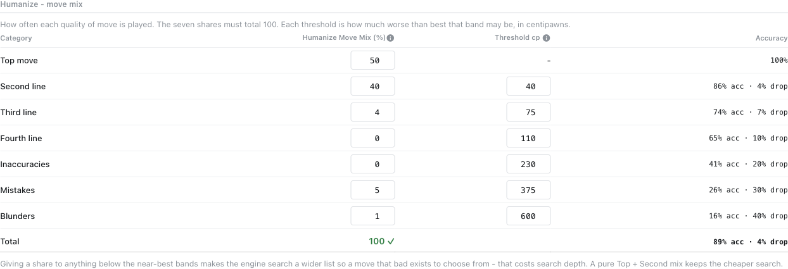

Humanize makes the engine play like a person at a chosen rating instead of always playing its top move.

- **Move mix** - seven shares set how often it plays the top move, a 2nd/3rd/4th line, an inaccuracy, a mistake or a
  blunder, with per-category centipawn thresholds (defaults on Lichess's own 110 / 230 / 377cp boundaries) and a live
  [Lichess accuracy](https://lichess.org/page/accuracy) estimate. Nothing past the blunder threshold is played, and
  blunders never fire in a decided game.
- **Play like rating** - the one rating used by Maia and by the options below.
- **Err Like Your Rating** (on by default) - replaces the move mix with what players of that rating actually do, drawn
  from their measured spread.
- **Guards** (on by default) - stop a planned error from doing what nobody plays on purpose: hanging a minor piece or
  more, giving back a winning position, or skipping the punishment of a blunder. The panel says "guard held" when one
  kept the engine's move.
- **Human-Like Mistakes** (on by default) - picks the error by how likely Maia-3 thinks a player of that rating is to
  play it. Needs the 88 MB Maia-3 net (downloaded the first time), standard chess only.
- **Target accuracy** (optional) - aims the game's accuracy at a number you set. Over 144 simulated games against
  Stockfish at 1500 and 2200, targets of 85 to 95 landed within about a point.
- **Scale Errors to the Clock**, **Mistakes Where People Make Them** and **Think Like Your Time Control** (optional) -
  tie error rates and think times to the clock and to the positions where players of that rating go wrong.

How each option works and what it was measured against: [docs/humanize-details.md](docs/humanize-details.md).

**Timing.** Moves are quick when obvious and through the opening, long in critical positions, and instant for true
recaptures, forced moves and your first move. **Clock Mode** budgets each move off the page clock (~time/30 + 60% of
the increment). **Mirror Time** paces to a share of the opponent's last spend, 50-150% (90 by default); being behind on
the clock always cuts the target by a further 30%. Both size the search to the wait. **Pace to Clock** (off) shortens
the *simulated* delay when the clock gets short, and never lengthens it.

> **Priority** - *Time:* Mirror ▸ Clock ▸ Humanize ▸ Search Time. *Move:* Book ▸ Humanize ▸ engine best.

### Puzzles

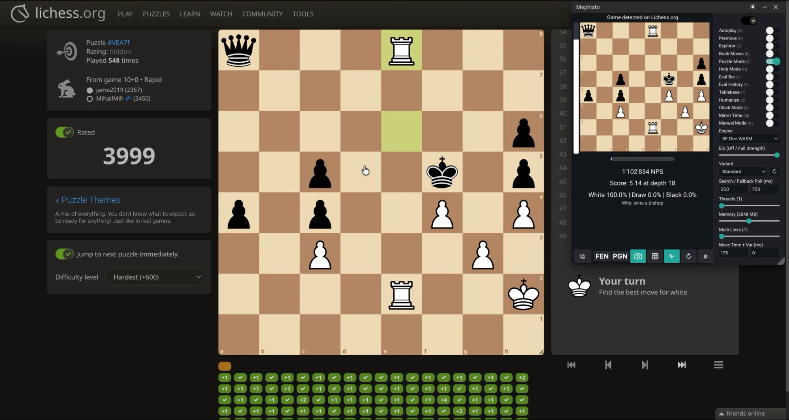 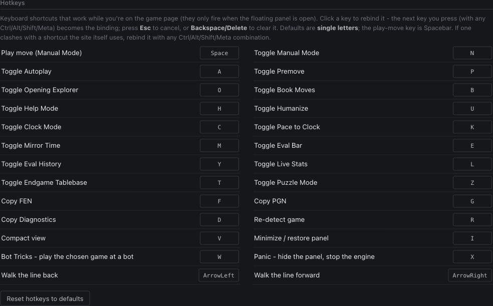

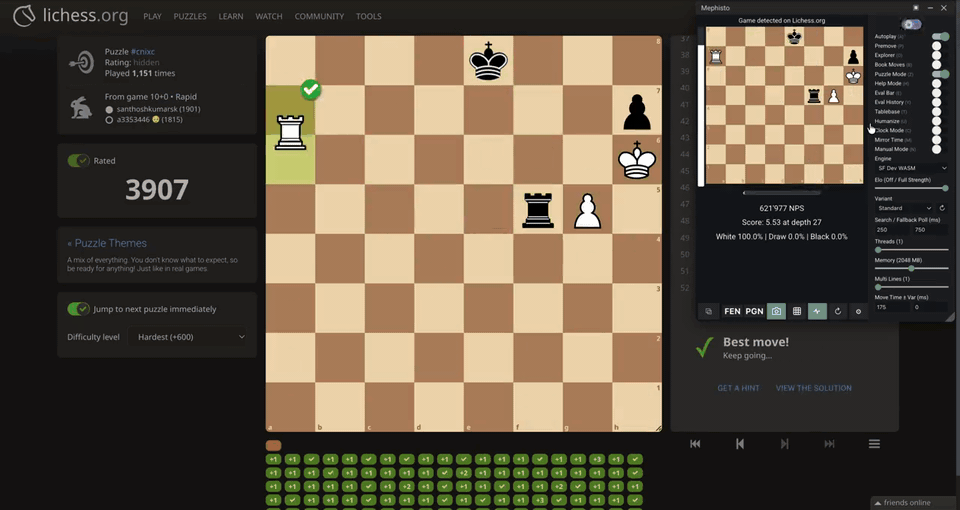

*3999 is the ceiling · every action rebindable · hardest (+600) puzzles back to back, from the database rather than
searched ([full clip](docs/puzzle-database.mp4)).*

**Puzzle Mode** optimises for solving speed. A puzzle page ships no move list, so the position is rebuilt from the
pieces alone: en passant from the last-move highlight, castling rights from the king and rook still at home.

**Puzzle database** - an objectively stronger move can still fail a puzzle, so importing Lichess's database lets the
panel look the position up and play the whole solution with **no search at all**. Chess.com puzzles import too, in their
own format (detected from the file), and both can be loaded at once.

**Read solutions from the page** (off by default) - the puzzle sites hand their own client the answer so they can score
you locally, so Puzzle Mode can read it there: no search, no database. A solution is used only if it replays legally
*and* belongs to the position on the board. Some chess.com modes fetch puzzles too early to watch; a second opt-in
catches them through Chrome's debugger, at the cost of the yellow "being debugged" bar.

<details>
<summary><b>Importing the Lichess database</b> - about a gigabyte, roughly half an hour, once</summary>

Not bundled. Download `lichess_db_puzzle.csv.zst` from [database.lichess.org](https://database.lichess.org/#puzzles),
decompress it (`unzstd lichess_db_puzzle.csv.zst` - browsers have no zstd decoder), then pick the `.csv` under
**Settings → Puzzles → Puzzle Database**. About six million positions, live count as it goes, nothing sent anywhere.
An interrupted import loses nothing - run it again and it fills in the rest.
</details>

<details>
<summary><b>Building your own Chess.com puzzle CSV</b> - the format the importer accepts</summary>

**The header row is required and must begin with `fen3`** - that is the only thing distinguishing a Chess.com file
from a Lichess one. Columns, in this order: `fen3,id,rating,initialFen,tcnMoveList,colorOfUser,pgn,passRate,averageSeconds,gameLiveId,gameId`.
Only `fen3` (board + side + castling, the first two fields are the key), `id`, `tcnMoveList` and - for rated tactics -
`colorOfUser` are read; `daily-N` rows carry SAN in the move column and need `initialFen`.

**Whose move comes first differs by row type**, and getting it wrong shifts every solution by a ply: a rated tactic's
`fen3` is the *opponent* to move, so the importer applies that setup move and keys on the position after it, while a
`daily-` row's side to move **is** the solver.

**TCN** is two characters per move, index `0` = `a1`, `63` = `h8`, over
`abcdefghijklmnopqrstuvwxyzABCDEFGHIJKLMNOPQRSTUVWXYZ0123456789!?{~}(^)[_]@#$,./&-*++=`. A promotion pushes the
destination past 63: the piece is `"qnrbkp"[(to - 64) / 3]` and the destination `from ± 8 + ((to - 64) % 3) - 1`.

Write real CSV (the `pgn` column holds literal newlines and doubled quotes), key on the first three FEN fields only,
and branch on `id` before choosing an encoding. Unreadable rows are skipped, not fatal.
</details>

### The panel

Drag by the title bar, close with ✕. **Compact (▣)** collapses it to the status line; **minimize (–)** hides it behind a
badge while autoplay keeps running. Quick Settings edits the common settings inline. **Re-detect (↻)** rescans the page.
**Copy FEN / PGN** exports a custom start with `SetUp`/`FEN` tags; switch on **Evals In Copied PGN** and every ply
carries the panel's own `{[%eval] [%depth]}`. A **grid button** takes a pasted FEN, **⧉** opens the position on Lichess,
and an **engine health dot** shows whether a native host answered.

---

## Supported sites

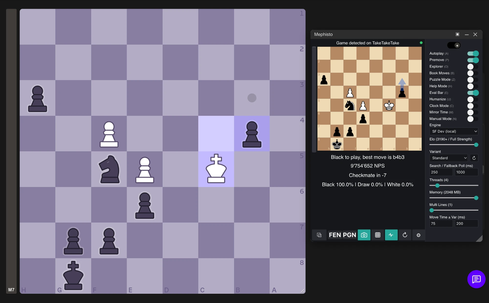

*TakeTakeTake, whose board is a WebGPU canvas with no DOM to scrape.*

| Site | Analysis | Autoplay | Premove | Puzzles | Online | Variants |
|---|:---:|:---:|:---:|:---:|:---:|---|
| **Chess.com** | ✅ | ✅ incl. Play Bots | ✅ | ✅ Rated · Rush · Learning + page-read solutions | ✅ | 3-Check, KotH, Crazyhouse, Antichess, Atomic, Horde, Racing Kings, **Duck, Minihouse, Seirawan, Chaturanga** + Chess960, **4-player** |
| **Lichess** | ✅ | ✅ incl. AI & From Position | ✅ | ✅ Training · Storm · Racer · Streak | ✅ live & correspondence | All Lichess variants + Chess960 |
| **TakeTakeTake** | ✅ | ✅ bot games | ✅ | - | ✅ Lichess-backed | - |
| **BlitzTactics** | ✅ | ✅ | - | ✅ puzzle streams | - | - |
| **ChessBase Tactics** | ✅ arrows on the canvas | ✅ | - | ✅ Solve / Sprint | - | - |

---

## Full-power native engines (optional)

**You don't need this.** The bundled WASM engines work with zero setup, but WASM is sandboxed: it can't use all your
cores or much RAM, so it runs **5-70× slower** than a native binary. Point Mephisto at a native Stockfish and Chrome
**auto-launches** it; there is no server to run.

<details>
<summary><b>Setup</b> - macOS, Linux, Windows</summary>

You need a native **Stockfish** (optionally **Fairy-Stockfish** for variants), **Python 3** with `python-chess`, and
your **extension ID** from `chrome://extensions` with Developer mode on.

> ⚠️ An unpacked extension's id **changes when you reload it**. If native engines stop working after a reload, re-run
> the install command with the new id.

> After **updating** Mephisto, re-run the install command as well (on Windows, redo its Windows steps): the hosts
> are copies, and an update does not touch them. The panel's engine dot turns amber while a host is out of date.

**macOS**
```bash
brew install stockfish fairy-stockfish
python3 -m pip install chess
native-host/install-native.sh --ext-id YOUR_EXTENSION_ID
```
A binary downloaded from the web is quarantined by Gatekeeper - the installer clears that for its own copy.

**Linux**
```bash
sudo apt install stockfish
python3 -m pip install chess
native-host/install-native.sh --ext-id YOUR_EXTENSION_ID
```
For Fairy-Stockfish, install it or pass `--fairy /path/to/binary`. On an install from the slim zip the installer also
downloads the Fairy-Stockfish nets the zip leaves out (299 MB, each checked against the release's SHA-256), once;
`--no-fairy-nets` skips that, and the native Fairy then plays on its classical evaluation.

**Windows** - native messaging needs a registry key, so this is manual. Install Python and `pip install chess`, and
download `stockfish.exe`. The host takes its name from its own file name, so the names have to line up:
1. In a stable folder, copy `native-host/uci-native-host.py` as **`sf-native-host.py`** and create **`sf-native.path`**
   beside it holding the full path to `stockfish.exe` (for Fairy-Stockfish: `fairy-native-host.py` and
   `fairy-native.path`).
2. Beside them, a copy of `native-host/tetrarch-host.bat` named `sf-native-host.bat`, with `tetrarch-host.py`
   changed to `sf-native-host.py` on both of its lines (Chrome on Windows runs a `.bat` or `.exe`, never a `.py`).
3. A host manifest `com.sf_native.host.json` (underscores - Chrome rejects hyphens) with `"name": "com.sf_native.host"`,
   `"type": "stdio"`, `"path"` = the `.bat`, and `"allowed_origins": ["chrome-extension://YOUR_EXTENSION_ID/"]`.
4. Registry key `HKCU\Software\Google\Chrome\NativeMessagingHosts\com.sf_native.host` with its default value = the
   manifest's full path (`com.fairy_native.host` for Fairy-Stockfish).
5. Fairy-Stockfish only: fetch its nets (299 MB, each checked against the release's SHA-256) into a folder of their own,
   outside the extension: `py -3 native-host\fetch-fairy-nets.py src\offscreen\engine-assets.json C:\fairy-nets`. Then
   create **`fairy-native.nnue-dir`** beside the host holding that folder's full path. Without it the native Fairy
   plays every variant on its classical evaluation.

The installer registers the host for every Chromium-family browser it knows: **Chrome, Brave, Edge, Chromium,
Vivaldi, Arc, Opera and Opera GX**, with their beta, dev and canary channels. Firefox isn't supported for
native engines. Any native build unlocks full speed - the gap between native builds is small, the jump from WASM to
any of them is huge.
</details>

---

## Four-player chess

Chess.com's **4-player chess** (`/variants/4-player-chess`) is analysed by
[Tetrarch](https://github.com/IchNukeDichWeg/Tetrarch), a purpose-built engine for 14×14 four-seat boards. Pick
**Tetrarch (4-player)** in the engine dropdown; the panel switches to it on a four-player board and back when you leave.

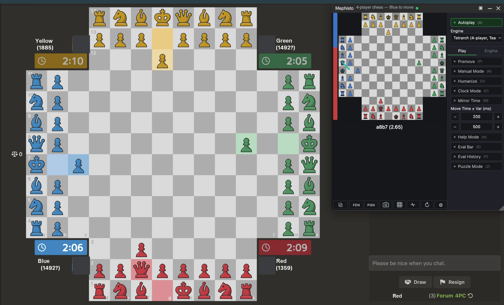

*Teams mode - the panel's own 14×14 board, rotated so you sit at the bottom, with the engine's move drawn on it.*

The evaluation is normalised to **your team** (Red+Yellow against Blue+Green) so it means one thing all game. Autoplay
works, on the analysis board too. **Free-for-all plays as well**, searched paranoid in the root seat's own terms.
Promotions are played in full (chess.com's picker is found by its shape, not a class name). Chess.com's mode label
decides the rules, and promotion is the 8th rank in free-for-all and the 11th in Teams, so **Mode** in the panel
overrides the label when that guess is wrong.

<details>
<summary><b>Setup</b> - macOS, Linux, Windows</summary>

Tetrarch is the one engine with nothing bundled behind it. Until it is installed the panel says so rather than
pretending to analyse. You need **Python 3**, a C compiler, and your **extension ID**.

**macOS and Linux**

```bash
git clone https://github.com/IchNukeDichWeg/Tetrarch
```

```bash
cd Tetrarch && ./setup.sh
```

Then, from the Mephisto folder:

```bash
native-host/install-native.sh --ext-id YOUR_EXTENSION_ID --tetrarch /path/to/Tetrarch
```

Drop `--tetrarch` if the checkout sits beside the Mephisto folder (in the same parent folder) - that's where the
installer looks.

**Windows** - the C core has to be built as a DLL and Chrome finds hosts through the registry, so there is a
PowerShell installer instead. Install [MSYS2](https://www.msys2.org), then from its **MINGW64** shell:

```bash
pacman -S --needed mingw-w64-x86_64-gcc
```

```bash
cd /c/path/to/Tetrarch && ./setup.sh
```

That produces `build\tetrarch.dll`. Then, from PowerShell in the Mephisto folder:

```powershell
powershell -ExecutionPolicy Bypass -File native-host\install-tetrarch.ps1 -ExtId YOUR_EXTENSION_ID
```

Add `-Tetrarch C:\path\to\Tetrarch` if the checkout isn't beside the Mephisto folder (in the same parent folder). No
administrator rights needed; Python 3 must be on `PATH`, with numpy in it (`py -3 -m pip install numpy`): setup.sh
installs numpy into MSYS2's Python, not that one.

> The Windows path is **built and symbol-checked but not yet run on a real Windows machine**. If something
> misbehaves, [please open an issue](https://github.com/IchNukeDichWeg/Mephisto/issues/new/choose) - see
> [Contributing](#contributing) for the four stages worth reporting. **WSL** works today, since it's the Linux path.
</details>

---

## Languages

**Settings → Appearance → Language**, applied immediately without a reload. English, Deutsch, Español, Français,
Português, Italiano, Nederlands, Polski, Türkçe, Русский, 中文, हिन्दी, 日本語, 한국어, each listed in its own language.

This is deliberately **not** Chrome's `chrome.i18n`, which follows the browser's UI locale with no way to override it.
There is one flat JSON per language under `src/i18n/locales/`, with English underneath as the fallback. Every string is
translated, long settings tooltips included. Engine names, themes and chess notation are left alone on purpose.

---

## Settings reference

Right-click the toolbar icon → **Options**, or use the gear in the panel. Quick Settings in the panel is a subset
writing to the same storage, and everything applies to the next move without a reload. **Every setting explains itself
in a tooltip on that page, in all fourteen languages.** That is where the reference lives; it cannot go stale the way a
copy here would.

Five are worth knowing before you go looking:

| Setting | Why it matters |
|---|---|
| **Threads** / **Memory** | A fresh install takes half your cores. In-browser engines are clamped to 512 MB by the WebAssembly heap limit; native engines get the full value. |
| **Panel Style** | **Floating panel** lives in the page and is required for Autoplay and Premove. **Toolbar popup** leaves zero page footprint unless an on-board drawing is on (see [Footprint](#page-footprint)) and closes when you click the board. |
| **Colour-blind palette** | One click on the Appearance page replaces every arrow colour with the Okabe-Ito set, which stays distinguishable under the common forms of colour blindness. The shipped colours separate lines by red against green, the one pair that collapses. |
| **Playstyle** | Ten characters chosen among lines the engine already called equal: *Attacking*, *Quiet*, *Greedy*, *Space*, *Sacrifice*, *Safe*, *Drawish*, *Ultra attacking*, *Disrespect*, and *Balanced* (the engine's own pick). Never at a cost: **35cp**, or two thirds of the top move's probability on a human net. Needs **Multi Lines ≥ 2**, and hides itself where it cannot apply. |
| **Lichess API token** | The Opening Explorer is behind OAuth now, so without a token it answers 401. Make a personal token with **no scopes** ticked. It is sent nowhere but lichess and is left out of diagnostics and exports. |

---

## Error codes

When something you started fails, Mephisto shows a short message with a stable code in front of it, for example
`MPH-U02: That isn't Mephisto's folder. Pick the folder you loaded in chrome://extensions (Load unpacked).` The message
is translated into your language; the code never is, so it can be searched for and quoted in a bug report. The
technical detail (a file name, an HTTP status, the browser's own text) is in the console, and in the text **Copy error &
open ticket** prepares. A code is never reused: a retired one stays retired.

### Automatic updates (Settings → Updates)

| Code | What happened | What to do |
|---|---|---|
| `MPH-U01` | The folder you picked has no `manifest.json`, so it is not an unpacked extension. | Pick the folder you loaded in `chrome://extensions` with **Load unpacked**. |
| `MPH-U02` | The folder holds a different extension, not Mephisto. | Pick the folder you loaded in `chrome://extensions` with **Load unpacked**. Nothing is written to a folder that fails this check. |
| `MPH-U03` | Install was pressed while Automatic Updates is switched off. | Switch it on under Settings → Updates. |
| `MPH-U04` | Chrome no longer holds the download permission the feature asked for. | Switch Automatic Updates off and on again; Chrome asks again. |
| `MPH-U05` | No extension folder is saved, or Chrome stopped allowing writes to it (it can lapse across restarts). | Press **Choose Extension Folder** and allow access. |
| `MPH-U06` | GitHub, or the extension's own release lookup, did not answer. | Check your connection and try again. Updating by hand still works. |
| `MPH-U07` | The newest release has no update archive attached. | Download the full zip from the Releases page. |
| `MPH-U08` | GitHub answered the download with an HTTP error (the status is in the console). | Wait a minute and try again. |
| `MPH-U09` | The download is the full archive (it holds `lib/engine`), not the ~7 MB update one. It is refused before anything is written. | Update by hand with the full zip. |
| `MPH-U10` | The archive is damaged: not a zip, a bad record, an unsupported compression method, or a file that inflated to the wrong size. The folder was not touched. | Try again; if it repeats, install the full zip and report the code with the console line. |
| `MPH-U11` | The archive is intact but is not the release it was published as: a missing core file, a wrong version, or a path outside the extension. The folder was not touched. | Try again later, or install the full zip. |
| `MPH-U12` | Roll back was pressed with no backup on disk. | Nothing to do; a backup exists only after an update installed through this feature. |
| `MPH-U13` | The backup is missing its manifest or a file it lists. Nothing is restored rather than half of it. | Install the version you want from its zip. |
| `MPH-U14` | Finish Interrupted Update was pressed but no update was interrupted. | Nothing to do. |
| `MPH-U15` | The staged update is incomplete (it is only finishable once every file and the final marker were written). | Press **Install Update**; it downloads the archive again. |
| `MPH-U16` | The release was built for different engine files (`lib/engine`, `lib/ort`) than the install has, and the update archive does not carry them. This happens when you skip a release that changed them. Nothing was written. | Download the full zip from the Releases page and install it by hand. |
| `MPH-U17` | The folder is Mephisto, but not the copy Chrome is running: it holds another version (an older extracted zip, say) or another manifest key. Nothing is written to it. | Pick the folder `chrome://extensions` shows for Mephisto. If you just updated that folder by hand, reload the extension there first. |
| `MPH-U18` | A file write failed while an update, a finish or a roll back was putting files in place (a file locked by antivirus, a disk error), so the folder holds parts of two versions. The browser's own message is in the console. | Press **Finish Interrupted Update** or **Roll Back**, whichever Settings shows, before the extension is next loaded. |
| `MPH-U19` | The folder holds the same Mephisto version as the one running, but it is another copy (the zip extracted twice, say): a check file written into it is not served by the running extension. Nothing else is written to it. | Pick the folder `chrome://extensions` shows for Mephisto. |

### Puzzle database (Settings → Puzzle Database)

| Code | What happened | What to do |
|---|---|---|
| `MPH-P01` | You picked the `.zst` file; browsers cannot decompress zstd. | Run `unzstd lichess_db_puzzle.csv.zst`, then pick the `.csv`. |
| `MPH-P02` | The import stopped with an error (details in the console). Positions already written are kept. | Run the import again; it continues over the same keys. |
| `MPH-P03` | The file was read but no puzzle in it was recognised (wrong CSV, or empty). | Pick `lichess_db_puzzle.csv` or a Chess.com puzzle CSV. |
| `MPH-P04` | The stored database could not be read. | Reload the page; if it persists press **Remove** and import again. |

### Settings import (Settings → Import Settings)

| Code | What happened | What to do |
|---|---|---|
| `MPH-S01` | The file is not valid JSON. | Pick a file made with **Export Settings**. |
| `MPH-S02` | The file is JSON but not a settings export (it must be an object of JSON strings). | Pick a file made with **Export Settings**. |
| `MPH-S03` | One value inside is not valid JSON, so nothing was imported. The code line names the setting. | Export again from a working install, or delete that entry from the file. |

### Opening book (Settings → Own Book)

| Code | What happened | What to do |
|---|---|---|
| `MPH-B01` | The file is not a Polyglot book: empty, a length that is not a multiple of 16 bytes, or entries out of order. | Pick a `.bin` in the Polyglot format. |

### Endgame tablebase (Settings → Tablebase)

| Code | What happened | What to do |
|---|---|---|
| `MPH-T01` | The chosen folder holds no Syzygy `.rtbw` files. | Pick the folder that contains them. |
| `MPH-T02` | Chrome dropped the folder grant for this session. | Press **Re-allow**. |
| `MPH-T03` | Write access to the folder was refused when starting a download. | Press **Download tables** again and allow it. |
| `MPH-T04` | The permission to reach `tablebase.lichess.ovh` was refused. | Press **Download tables** again and allow it. |
| `MPH-T05` | The server's file list could not be read. | Check your connection and try again. |
| `MPH-T06` | The disk filled up; the run stopped instead of failing every remaining file. | Free space or pick the smaller 3-4-5 set. |
| `MPH-T07` | **Check** could not use the folder; the reason is in the brackets. | Choose the folder again; for a native-host reason re-run `native-host/install-native.sh`. |

### Engines (panel)

| Code | What happened | What to do |
|---|---|---|
| `MPH-E01` | The native engine host is not installed, was removed, or could not start. | Run `native-host/install-native.sh` once (on Windows, the manual steps; see [Full-power native engines](#full-power-native-engines-optional)), then reload the page. Hosts are per browser. |
| `MPH-E02` | The Remote Engine is selected but nothing answers on `localhost:9090`. | Start `remote-engine.py`, or pick another engine. |
| `MPH-E03` | Something answers on `localhost:9090` that is not `remote-engine.py` (it returned HTML, not JSON). | Stop it or start `remote-engine.py` there. |
| `MPH-E04` | The in-browser engine crashed three times in a row. | Pick a different engine in Settings. |
| `MPH-E05` | An engine failed to load or run for a reason with no code of its own. The panel shows the first 120 characters; the console has all of it. | Reload the page; if it repeats, report the code with the console line. |
| `MPH-E06` | The online (cloud) engine did not answer: offline, rate-limited, or it refused the position. | Check your connection, or pick another engine. |
| `MPH-E07` | Tetrarch (four-player chess) is not installed. | Follow the [Four-player chess](#four-player-chess) setup. |
| `MPH-E08` | The native Fairy-Stockfish was asked for Duck, Minihouse, Seirawan or Chaturanga. Its host builds positions with python-chess, which has no board for those four. | Pick the built-in Fairy-Stockfish for these variants. |
| `MPH-E09` | `remote-engine.py` (or `mephisto-clicker.py`) took more than 28 seconds to answer, so the request was dropped before Chrome's 30-second limit could stop the extension's background worker. | Check that program's window for errors, or restart it. |
| `MPH-E10` | Chrome refused to attach its debugger to the game tab, so Autoplay could not click (Chrome's reason is in the brackets). Usually another extension's frame in the page (a password manager, a writing assistant) or a browser policy. The move is not retried on that position. | Play the move yourself, or try with other extensions switched off. |

### Model and net downloads (first use of an engine)

| Code | What happened | What to do |
|---|---|---|
| `MPH-N01` | A net or model file this build does not bundle could not be downloaded (offline, blocked, or an HTTP error; the file name is in the console). | Check your connection and try again. |
| `MPH-N02` | The download stopped early or ran past the size the manifest lists. | Try again. |
| `MPH-N03` | The file arrived but failed its SHA-256 check, so it was discarded and not cached. | Try again; if it repeats, install the full zip. |
| `MPH-N04` | The file is neither bundled nor named in `engine-assets.json`. | Update Mephisto or install the full zip. |

### Game Review (chess.com, lichess)

| Code | What happened | What to do |
|---|---|---|
| `MPH-R01` | The chess.com review runs inside a chess.com tab and none could be found or opened. | Open chess.com in this browser and log in. |
| `MPH-R02` | chess.com closed the review socket with 1008 (not authenticated). | Sign in to chess.com in this browser and try again. |
| `MPH-R03` | chess.com gave no answer: the socket would not open, failed to send, or closed with nothing. | Try again; if it repeats use **Copy error & open ticket** (the technical detail is in the ticket text). |
| `MPH-R04` | The review could not run inside the chess.com tab, or the tab returned nothing. | Reload that tab and try again. |
| `MPH-R05` | lichess answered 429. | Wait a minute. The anonymous import is limited to 100 an hour. |
| `MPH-R06` | lichess answered 401 to **Add to my study**: the token is unknown or expired. | Make a new token with the `study:write` scope. |
| `MPH-R07` | lichess answered 403: the token lacks `study:write`. | Make a new token with `study:write` ticked and paste it in Settings → Beyond the engine → Lichess API token. |
| `MPH-R08` | lichess answered 404: no such study, or not one this token can write to. | Check the URL, and that the study is yours or you are a contributor. |
| `MPH-R09` | lichess refused the game with another status; the status and its message are in the brackets. | Check the PGN and try later. |
| `MPH-R10` | lichess could not be reached. | Check your connection and try again. |
| `MPH-R11` | **Add to my study** was pressed with no study URL. | Paste the URL of one of your studies. |
| `MPH-R12` | **Add to my study** was pressed with no token saved. | Make a token at `lichess.org/account/oauth/token/create` and paste it in Settings → Beyond the engine → Lichess API token. |
| `MPH-R13` | **Check for update** on the Game Review engine could not reach chess.com, got a status other than 200/404, or every probe answered (a proxy in the way). The status is in the brackets. | Try again later. |

### Screen reading (panel)

| Code | What happened | What to do |
|---|---|---|
| `MPH-V01` | No board was found in the screenshot. | Drag a box around the board when asked. |
| `MPH-V02` | The screenshot itself failed. | Keep the tab visible and try again. |
| `MPH-V03` | Follow Screen stopped because a capture failed. | Press it again. |
| `MPH-V04` | The recogniser failed for a reason with no code of its own (in the brackets). | Drag a box around the board, or reload the page. |

---

## Page footprint

**Toolbar popup** leaves **zero page footprint**: it renders in the browser's own chrome. There are two exceptions:
**Read solutions from the page**, which adds a page-world script on puzzle pages that wraps `fetch`, XHR and
`WebSocket` (whichever panel style you use), and drawing on the site's board (Help Mode, Eval Bar, Eval History, Live
Stats, Move Classification or Evals on Your Arrows), which the open popup does under the same closed shadow root the
floating panel uses. The popup closes when you click the board, so it is analysis only; Autoplay and Premove need the
floating panel (**Settings → Panel → Panel Style**). While the floating panel is in use:

- **No iframe.** An iframe is counted by `window.length` and a closed shadow root cannot hide it. The panel renders in
  the page's isolated world, and the WASM engine lives in an offscreen document.
- **No extension URLs reach the page.** `web_accessible_resources` is gone; markup, CSS and images are injected as
  inlined bytes or `data:` URIs, so no `chrome-extension://` URL appears in the DOM or in Resource Timing.
- **Closed shadow root** under one attribute-less host node, and **no branded page globals** (MAIN-world probes talk
  over per-session random event channels).
- **Human-shaped clicks.** A bare *from → to*, randomised timings, a center-weighted landing point and a jittered cursor
  path, priced by **Fitts's law**, with a share of long moves overshooting and correcting. The path shape is measured,
  not assumed: `test/cursor-oracle.mjs` records the `mousemove` stream a click emits, which is all a site can see. Its
  numbers stay in its output, because a published table of where a path peaks is a signature to match against.
- **Opponent lookups leave from the worker, never the tab**, so they are not attributable to the page.
- **Nothing loads where it isn't needed**, and **nothing goes in the site's storage**: the panel's position and the
  custom-start cache live in extension storage, per site.

These reduce *passive* fingerprinting only. See the [disclaimer](#fair-play---read-this-first).

---

## Roadmap

No schedule; things get added whenever I feel like it. **Shipped work lives in the
[releases](https://github.com/IchNukeDichWeg/Mephisto/releases)**, each with its own notes.

**Worth real work.**

- [ ] **Review the game you just finished, in one click** - the content script is already holding the moves.
- [ ] **Turn your own blunders into puzzles** - the review finds them and Puzzle Mode serves them; the bridge is missing.
- [ ] **A command palette** - one key and a search box over the actions the hotkey system already names.
- [ ] **Grind Mode, the rest of it** - stop after N games or a losing streak, respect a daily limit, pick the time
  control, and know whether you are still at the keyboard.
- [ ] **Talking Mode - why this move and not that one.** A running explanation of the live board instead of a number and
  an arrow, once the search settles. Three layers that each stand on their own: the facts from our own engine (where the
  best line and the move you are looking at part, and what the refutation wins); chess.com's explanation engine run live
  on lines nobody played (tested, and it returns why a move fails, what to play instead and the refutation; still owed:
  running it from the offscreen page); and a language model as the voice, never the judge (Chrome's built-in model or
  your own API key, rewording the facts only).
- [ ] **Drill mode** - the puzzle database, the explorer's statistics and Maia at a rating band, pointed at a
  repertoire.
- [ ] **Your history across games** - accuracy over time, and which openings actually lose.

**Known problems.**

- [ ] **Playing while the machine is busy** - on a saturated 10-core Mac the panel's response went from a 323ms median to
  1239ms, and fewer engine threads made it *worse*, so the cost is the page thread. Overlay redraws are now coalesced
  to one per animation frame (v3.1.302); **the confirming saturated-machine run is still owed**.
- [ ] **The pause after a browser restart** - unresponsive for several seconds, then it recovers. Never explained; the
  worker's cold-start timings are recorded now.
- [ ] **Four-player chess, the rest of it** - no real game has been seen past an elimination, so that path is pinned by
  synthetic positions. Chaturaji, 4P Giveaway and Self Partnering are untouched. On Windows it is built and
  symbol-checked but never run.
- [ ] **Duck Chess autoplay** - blocked on the engine: this Fairy build declares 84 variants and duck is not one, so it
  needs a rebuild.
- [ ] **Better board reading from the screen** - unusual piece sets, low resolution, boards at an angle. That means
  retraining the model.
- [ ] **A speed and polish pass on the panel**, **shrinking the footprint further** (the client side is nearly
  exhausted, and it was never what catches people), **more engines** (lc0 in WASM, for comparing styles), **short videos
  and more screenshots**, and **translating the README**.

**Speculative.** Mirroring another bot (doubles the footprint, and the shape of the moves is what catches people
anyway).

**Always open.** Bug fixes. Several of the sharpest so far were invisible rather than loud, so *"it did nothing"* is
worth more than it sounds. And whatever you want it to do; most of what is here arrived because something was annoying
in a real game.

**Blocked upstream** (no engine supports them): Fog of War, Spell Chess, Bughouse, Chess-with-Checkers.

**Looked at and dropped.** *Lichess cloud evaluation* is a crowdsourced cache, deep on openings and absent on ordinary
middlegames, the inverse of where extra depth would change a move. *Training more Maia bands* would duplicate Maia-3's
600-2600 slider, and human data thins out exactly where a new band would have to prove itself.

---

## Contributing

**[Open an issue](https://github.com/IchNukeDichWeg/Mephisto/issues/new/choose) for anything**: a bug, a site that
stopped being scraped, an engine that misbehaves, a feature you want, an idea. You don't need a diagnosis; "it stopped
playing moves on lichess this morning" is a perfectly good issue. PRs are welcome too.

**Paste a diagnostics report into the issue.** Press **D** on the page, or use the panel's **Engine** tab → **Copy
Diagnostics**. It carries the build, the engine, what was detected, whether the last move played (and why not, if it
didn't), and the recent trace, with **no addresses, no account, no token and nothing identifying**. Turn on **Verbose
Logging** first and reproduce the problem, and **copy while it is broken**, because reloading to get a clean report
throws away the state that explains the fault.

**If the Windows four-player setup fails, say which stage broke**, since each has a different cause: (1) `./setup.sh`
produces `build\tetrarch.dll`, (2) `python -c "from tetrarch import core"` imports, (3) `python uci.py` answers `go` in
a terminal, (4) the panel finds the engine in Chrome.

## License & credits

This project's own source (and the original [Mephisto](https://github.com/AlexPetrusca/Mephisto) by Alexandru Petrusca)
is **MIT** ([`LICENSE`](LICENSE)). It **bundles copyleft components** (GPL-3.0 engines and nets, and the **AGPL-3.0**
Maia-3 model), so the **combined distribution is governed by AGPL-3.0**. Before redistributing, read
[`LICENSING.md`](LICENSING.md) and [`THIRD-PARTY-NOTICES.md`](THIRD-PARTY-NOTICES.md); full texts are in
[`licenses/`](licenses/).

Built on the work of others, with thanks:

- **[Stockfish](https://github.com/official-stockfish/Stockfish)** & **[Fairy-Stockfish](https://github.com/fairy-stockfish/Fairy-Stockfish)** (GPL-3.0), run in the browser via the [Lichess Stockfish-web](https://github.com/lichess-org) builds.
- **[Maia](https://github.com/CSSLab/maia-chess) / [Maia-2](https://github.com/CSSLab/maia2) / [Maia-3](https://github.com/CSSLab/maia3)** (CSSLab, University of Toronto; GPL-3.0 / MIT / AGPL-3.0), the **[Maia 2200](https://github.com/CallOn84/LeelaNets)** and **Elite Leela** nets (CallOn84; GPL-3.0), and **[Leela Chess Zero](https://github.com/LeelaChessZero/lc0)** (GPL-3.0) for the input/policy encoding.
- **Board recognition** - two models from [Chess_diagram_to_FEN](https://github.com/tsoj/Chess_diagram_to_FEN) by Jost Triller (MIT), converted to ONNX; see `lib/engine/vision/`.
- **[ONNX Runtime Web](https://github.com/microsoft/onnxruntime)** (Microsoft; MIT) - in-browser inference.
- **Polyglot book format** - the 781 Zobrist constants a `.bin` book is keyed by (`lib/polyglot-random.js`), from Polyglot via **[python-chess](https://github.com/niklasf/python-chess)** (Niklas Fiekas; **GPL-3.0**). They are the format's published data: a book cannot be read without exactly those values. The reader itself is this project's code.
- **[chess.js](https://github.com/jhlywa/chess.js)** (BSD-2), **[chessboard.js](https://github.com/oakmac/chessboardjs)**, **[jQuery](https://jquery.com)**, **[Materialize](https://materializecss.com)** and `lru` (all MIT).
